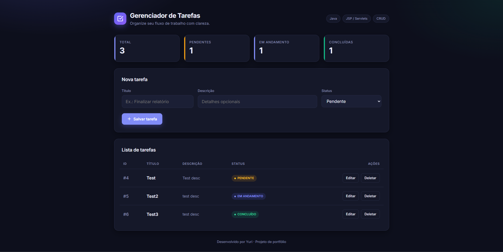

# 📋 J2EE / Jakarta EE CRUD Manager

A Web application built with Java for task management, implementing the **MVC (Model-View-Controller)** pattern using **Servlets**, **JDBC**, and **MySQL**.

---

## 📸 Preview

<p align="center">
  
</p>

---

## 🚀 Tech Stack

- **Language:** Java 17+
- **Web Specification:** Jakarta EE 10 (Servlets & JSP)
- **Application Server:** Apache Tomcat 10.1
- **Build & Dependency Management:** Apache Maven
- **Database:** MySQL 8+
- **Persistence:** Native JDBC (Java Database Connectivity)

## 🏗️ Architecture & Project Structure (MVC)

- `com.yuri.model`: Domain entity model (`Tarefa.java`).
- `com.yuri.dao`: Data Access Object layer executing SQL queries via JDBC (`TarefaDAO.java`).
- `com.yuri.config`: Database connection factory setup (`ConnectionFactory.java`).
- `com.yuri.controller`: Intercepts and routes HTTP requests (`TarefaServlet.java`).
- `src/main/webapp`: View layer rendered with dynamic JSP (`index.jsp`).

## ⚙️ Database Setup

Run the following SQL script in MySQL Workbench:

```sql
CREATE DATABASE IF NOT EXISTS j2ee_db;

USE j2ee_db;

CREATE TABLE IF NOT EXISTS tarefas (
    id INT AUTO_INCREMENT PRIMARY KEY,
    titulo VARCHAR(100) NOT NULL,
    descricao TEXT,
    status VARCHAR(20) DEFAULT 'PENDENTE'
);
